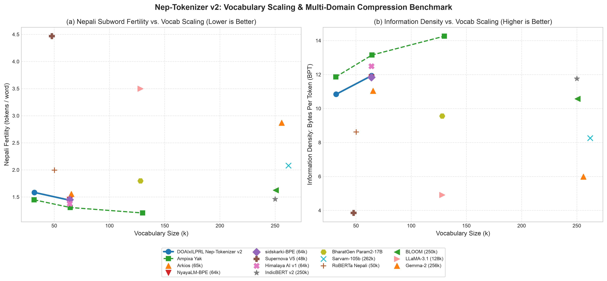
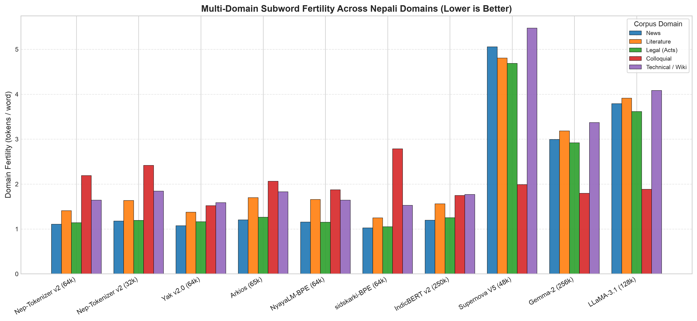
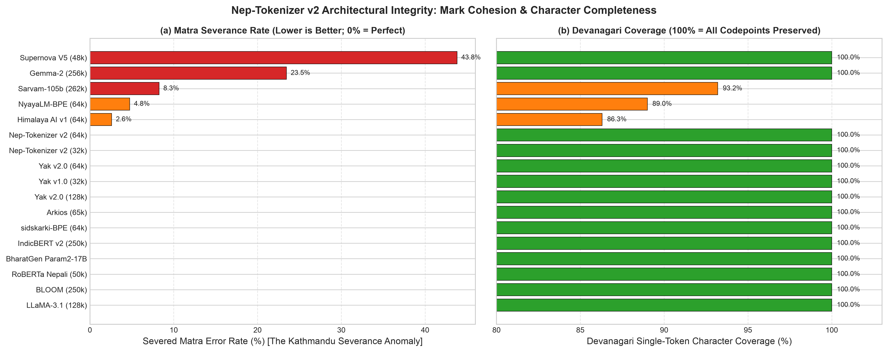

# Nep-Tokenizer: Open, Lossless, Mark-Aware Devanagari Tokenization

**Department of Artificial Intelligence (DOAI) & Information and Language Processing Research Lab (ILPRL)**  
**Kathmandu University, Dhulikhel, Nepal**

[](https://huggingface.co/DOAIxILPRL-KU/nep-tokenizer)
[](https://opensource.org/licenses/MIT)
[-orange.svg)](https://github.com/huggingface/tokenizers)

**Nep-Tokenizer** is an open-source, reproducible, high-performance Devanagari tokenizer pipeline for Nepali and multilingual Large Language Models (LLMs). Version 2 (`v2.0`) introduces a native Hugging Face Rust-backed byte-level Byte-Pair Encoding (BPE) engine that resolves critical architectural flaws found in prior tokenizers—including the Devanagari vowel sign severance anomaly ("Kathmandu Bug"), tail character byte fragmentation, and arbitrary numeral shattering.

---

## Key Architectural Principles

1. **Native Hugging Face Compatibility**: Directly serializes to standard `tokenizer.json`, `tokenizer_config.json`, and `special_tokens_map.json`. Operates seamlessly via `AutoTokenizer.from_pretrained("DOAIxILPRL-KU/nep-tokenizer")` with zero C++ SentencePiece binary dependencies.
2. **Mark-Aware Pre-tokenization (`[\p{L}\p{M}]+`)**: Standard GPT-2/LLaMA-3 pre-tokenizers use `\p{L}+` which forcefully severs words at Devanagari vowel signs (*matras*) and virama (`\p{M}`), causing high fertility floors. Nep-Tokenizer v2 treats letters and combining marks as cohesive tokens, driving the **matra severance error rate to 0.00%** (100.0% matra cohesion).
3. **100% Devanagari Block Coverage**: Guarantees all 128 Unicode code points in the Devanagari block (`U+0900` to `U+097F`) have deterministic atomic merges. Zero byte fallbacks, zero raw byte triplets (`<0xE0>...`), and zero unigram drops for rare phonemes (`ऊ, ऋ, ॠ, ऐ, अं, अः, ॄ, ॅ, ॆ, ॉ, ॊ`).
4. **Isolated Digit Grouping (`[0-9०-९]{1,3}`)**: Automatically partitions both ASCII and Devanagari digits in groups of up to 3 digits before BPE merging, ensuring uniform representation across large numbers and preserving mathematical reasoning.
5. **Lossless Byte-Level Fallback & NFC Normalization**: NFC Unicode normalizer guarantees canonical combining representation, while ByteLevel fallback guarantees 100% roundtrip fidelity across all unseen UTF-8 bytes, code syntax, and emojis.

---

## Benchmark Leaderboard (Consistent Multi-Domain Evaluation)

Evaluated across a comprehensive held-out benchmark suite spanning **News**, **Literature**, **Legal Acts**, **Colloquial (Social Media)**, and **Technical / Wikipedia** domains:

| Model | Vocab Size | Nepali Fertility ↓ | English Fertility ↓ | Nepali Tax ↓ | Matra Err% ↓ | Devanagari Cov% ↑ | Bytes/Token (BPT) ↑ |
| :--- | :---: | :---: | :---: | :---: | :---: | :---: | :---: |
| **DOAIxILPRL Nep-Tokenizer v2 (64k)** | **64,053** | **1.440** | **1.289** | **1.12x** | **0.00%** | **100.0% (128/128)** | **11.93** |
| **DOAIxILPRL Nep-Tokenizer v2 (32k)** | **32,057** | **1.584** | **1.490** | **1.06x** | **0.00%** | **100.0% (128/128)** | **10.84** |
| **Ampixa Yak v2.0 (64k)** | 64,512 | 1.306 | 1.483 | 0.88x | 0.00% | 100.0% (128/128) | 13.15 |
| **Ampixa Yak v1.0 (32k)** | 31,744 | 1.448 | 1.658 | 0.87x | 0.00% | 100.0% (128/128) | 11.86 |
| **Ampixa Yak v2.0 (128k)** | 130,048 | 1.205 | 1.275 | 0.95x | 0.00% | 100.0% (128/128) | 14.26 |
| **Himalaya AI v1 (64k)** | 64,000 | 1.375 | 1.329 | 1.03x | 2.60% | 86.3% (63/73) | 12.49 |
| **Sajal Regmi Arkios (65k)** | 65,510 | 1.556 | 1.201 | 1.30x | 0.00% | 100.0% (128/128) | 11.04 |
| **sidskarki Nepali-BPE (64k)** | 64,000 | 1.450 | 2.772 | 0.52x | 0.00% | 100.0% (128/128) | 11.84 |
| **NyayaLM SentencePiece BPE (64k)** | 63,985 | 1.450 | 1.188 | 1.22x | 4.76% | 89.0% (65/73) | 11.84 |
| **AI4Bharat IndicBERT v2 (250k)** | 250,000 | 1.461 | 1.221 | 1.20x | 0.00% | 100.0% (128/128) | 11.76 |
| **BigScience BLOOM (250k)** | 250,680 | 1.625 | 1.228 | 1.32x | 0.00% | 100.0% (128/128) | 10.57 |
| **BharatGen Param2-17B** | 128,000 | 1.797 | 1.597 | 1.13x | 0.00% | 100.0% (128/128) | 9.56 |
| **IRIIS RoBERTa Nepali (50k)** | 50,256 | 1.994 | 7.893 | 0.25x | 0.00% | 100.0% (128/128) | 8.62 |
| **Sarvam AI Sarvam-105B (262k)** | 262,144 | 2.080 | 1.221 | 1.70x | 8.26% | 93.2% (68/73) | 8.26 |
| **Supernova V5 (48k)** | 47,908 | 4.468 | 1.799 | 2.48x | 43.82% | 100.0% (128/128) | 3.85 |
| **Google Gemma-2 (256k)** | 256,000 | 2.869 | 1.161 | 2.47x | 23.46% | 100.0% (128/128) | 5.99 |
| **Meta LLaMA-3.1 (128k)** | 128,000 | 3.498 | 1.235 | 2.83x | 0.00% | 100.0% (128/128) | 4.91 |

---

## Domain Breakdown (Tokens per Word)

| Domain | Nep-Tokenizer v2 (64k) | Nep-Tokenizer v2 (32k) | Yak v2.0 (64k) | Arkios (65k) | NyayaLM (64k) | Supernova V5 | Gemma-2 (256k) | LLaMA-3.1 (128k) |
| :--- | :---: | :---: | :---: | :---: | :---: | :---: | :---: | :---: |
| **News** | **1.106** | 1.179 | 1.058 | 1.196 | 1.116 | 4.072 | 2.502 | 3.018 |
| **Literature** | **1.409** | 1.549 | 1.278 | 1.528 | 1.417 | 4.410 | 2.837 | 3.461 |
| **Legal Acts** | **1.141** | 1.233 | 1.082 | 1.239 | 1.155 | 4.090 | 2.545 | 3.080 |
| **Colloquial** | **2.190** | 2.449 | 1.942 | 2.378 | 2.203 | 5.340 | 3.699 | 4.566 |
| **Technical / Wiki**| **1.643** | 1.838 | 1.439 | 1.777 | 1.637 | 4.675 | 3.078 | 3.737 |

---

## Visualizations

### 1. Vocab Size Scaling vs. Nepali Fertility & Information Density


### 2. Multi-Domain Compression Comparison


### 3. Matra Cohesion Rate & Devanagari Completeness


---

## Quickstart & Usage

### Fast Hugging Face `transformers`

```python
from transformers import AutoTokenizer

tokenizer = AutoTokenizer.from_pretrained("DOAIxILPRL-KU/nep-tokenizer")

text = "नेपालको राजधानी काठमाडौँ हो ।"
tokens = tokenizer.tokenize(text)
input_ids = tokenizer.encode(text)

print("Tokens:", tokens)
# ['नेपालको', 'राजधानी', 'काठमाडौँ', 'हो', '।']

print("Input IDs:", input_ids)
# [12117, 3517, 3497, 506, 311]

# 100% Exact Round-Trip Decoding
assert tokenizer.decode(input_ids) == text
```

---

## Reproducing the Pipeline

```bash
# 1. Setup virtual environment
pip install -r requirements.txt

# 2. Build training corpus (multi-source streaming)
python scripts/prepare_training_corpus.py

# 3. Train Nep-Tokenizer v2 (32k & 64k)
python scripts/train_hf_bpe.py --vocab-sizes 32000 64000

# 4. Run standardized 17-model benchmark
python scripts/benchmark_all_models.py

# 5. Regenerate publication figures
python scripts/generate_plots.py

# 6. Push 64k model to Hugging Face
python scripts/push_v2_to_hf.py
```

---

## Citation & Attribution

```bibtex
@misc{doai_ilprl_nep_tokenizer_2026,
  author = {Department of Artificial Intelligence (DOAI) and Information and Language Processing Research Lab (ILPRL)},
  title = {Nep-Tokenizer v2: An Open, Lossless, Mark-Aware Byte-Level BPE Tokenizer for Nepali and Multilingual LLMs},
  year = {2026},
  publisher = {Hugging Face},
  journal = {Hugging Face Hub repository},
  howpublished = {\\url{https://huggingface.co/DOAIxILPRL-KU/nep-tokenizer}},
  institution = {Kathmandu University}
}
```

### Reference Repositories & Research Works
- **Ampixa Labs**: *Yak: an open, lossless, Nepali-first tokenizer* ([GitHub](https://github.com/Ampixa/yak-tokenizer))
- **Sajal Regmi et al.**: *Vowel Signs Are Not Letters: The Anatomy of the Non-Latin Tokenization Floor* ([GitHub](https://github.com/sajalregmi/arkios-tokenizer))
- **Siddhartha Karki**: *Nepali Tokenizer Benchmark & Strategy Brief* ([GitHub](https://github.com/sidskarkii/nepali-tokenizer))
- **AI4Bharat**: *IndicBERT v2 & Sangraha*
